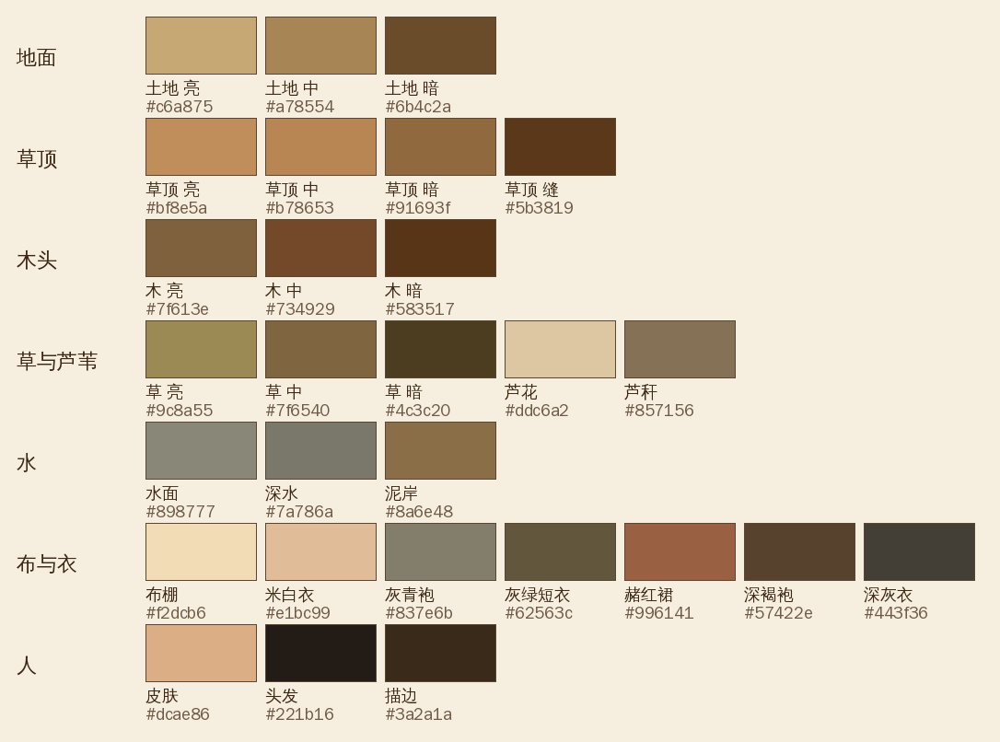

# 参考图拆解

> 用途：把参考图里的东西一件一件拆出来，记下视角、比例、颜色和画法，然后**用我们自己的方式重画**。
> 参考图来自别人的游戏截图，只能拿来学，不能抠图放进我们的游戏（版权问题；而且截图里物件互相遮挡、光影是画死的，抠出来也没法用）。所以参考图不放进仓库。
> 用 ChatGPT 生图时也一样：用文字描述风格，不要上传这些截图让它照着画。

## 视角与比例

| 项目 | 参考图 | 我们定的 |
|---|---|---|
| 视角 | 2:1 等距俯视，固定镜头 | 同样：1 格 = 1 米，格子在屏幕上宽 72 像素、高 36 像素 |
| 人物 | 约 7 头身，修长，脸上只有很淡的五官 | 身高 1.65 米，在 844 宽的横屏上约 66 像素 |
| 桌子 | 高约到人的腰 | 方桌 0.9 米见方、高 0.72 米；长凳高 0.45 米 |
| 布棚 | 后高前低，竹骨间布下垂，前沿一串弧 | 后沿高 2.5 米、前沿 2.05 米，5 段布 |
| 小草棚 | 单坡，两三根柱子 | 后高 2.25 米、前高 1.95 米 |

## 色板

颜色是用程序从参考图的像素里直接聚类取出来的，不是凭感觉调的。几个要点：
- 整张图带一层暖色调，**水面是偏暖的灰（`#898777`），不是蓝色**。
- 阴影是暖褐色，不是黑色。描边是细的深棕色。
- 衣服都是低饱和的颜色：灰青、灰绿、米白、赭红、深褐。

## 画法规则

1. **光从右上方来**，影子柔和，拖向左下。朝右下的面亮，朝左下的面暗。
2. **对比度低、颜色暖**，没有纯黑和纯白。
3. **地面不画格子**：大块的浓淡变化，加碎石、落叶、土粒。草地边缘是虚的，由一簇一簇的草丛组成。
4. **河岸**：土地和水之间有一道泥坡；水面靠岸处更暗，有零星的波纹和水草。
5. **草顶**：顺着屋檐方向的短草纹；檐口有参差的草茬；屋脊压竹竿，隔一段绑一道。
6. **布棚**：布在竹骨之间往下垂，有明暗；打补丁；前面的竿子用绳子斜拉、钉在地上。
7. **物件要密**：参考图的摊位四周塞满了筐、坛、麻袋、竹笼、晾着的东西。空地上也有零碎的小东西。
8. **遮挡**：棚下的东西会被棚顶挡住一部分，靠近棚边的才看得全。长的东西（篱笆、围墙）要分成小段，按各自的位置排前后。

## 物件清单

✓ = 开局茶摊用得到；★ = 样张 E 里已经用代码画了。

| 类别 | 物件 |
|---|---|
| 棚与房 | 布棚 ✓★、单坡小草棚 ✓★、大油纸伞 ✓★、草顶木屋、瓦房、二层楼、牌楼、栈桥 ✓★ |
| 篱笆与地面 | 竹篱笆 ✓★、木栅栏、石台阶、土路 ✓★、石板路 |
| 桌凳 | 方桌 ✓★、长凳 ✓★、矮架子 ✓★、方凳、柜台、货架 |
| 灶与炊具 | 泥灶 ✓★、风炉 ✓★、水壶 ✓★、蒸笼 ✓★、水缸 ✓★、茶碗 ✓★、铁锅、案板、菜刀 |
| 坛罐筐袋 | 酒坛（红布封口）✓★、麻袋 ✓★、竹筐 ✓★、柴堆 ✓★、鱼篓、竹笼 |
| 车船 | 篷船 ✓★、小舟、两轮板车、独轮车 |
| 自然 | 柳树 ✓★、芦苇 ✓★、草丛 ✓★、野花 ✓★、粟田 ✓★、菜地 ✓★、葫芦架 ✓★、花树、银杏、石头 |
| 动物 | 鸡 ✓★、驴、猪、狗、喜鹊、兔 |
| 人物 | 店家 ✓★、店家娘子 ✓★、挑夫 ✓★、船夫 ✓★、赶考书生 ✓★、行脚客 ✓★、农人 ✓★、渔夫 ✓ |
| 光效 | 炉火 ✓★、热气 ✓★、灯笼、雪、晨雾 |

## 和参考图的差距（样张 E）

对照图见本次交付。已经学到的：视角、比例、配色、棚子的结构、人物的身材和衣服样式。
差得最多的三处：
1. **物件密度**：参考图每平方米都有东西，我们的空地还偏多。
2. **材质**：参考图每个表面都有细节（木纹、布纹、陶器的釉），我们的偏平涂。
3. **暗部**：参考图在墙角、物件和地面的接触处都有柔和的暗影，立体感强；我们的少。

这三处都能靠继续往上加细节来改进，但用代码画会越来越费工夫。退路是让场景物件改用 ChatGPT 生成，见 [design.md](design.md) 的「美术」一节。
